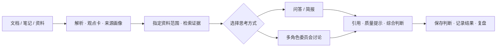

# ThinkRoom · 思考间

**让资料中的观点参与讨论，让每一次判断都能回到证据。**

ThinkRoom 是一款面向个人研究与决策复盘的开源多智能体思考工具。它把文档整理成可追溯的观点与证据，让不同分析视角围绕新问题进行问答、审议与综合，而不只是搜索后生成一段摘要。

[English](README_EN.md) · [体验演示](docs/DEMO.md) · [文档导航](docs/README.md) · [贡献指南](CONTRIBUTING.md) · [安全说明](SECURITY.md)

[](https://github.com/Gdnbit/thinkroom/actions/workflows/ci.yml) [](LICENSE)

## 先看一个例子

假设一间**虚构的社区图书馆**想知道：是否应该继续延长晚间开放时间？

上传的试点资料只告诉我们：

- 第一周到访 **80** 人次，第二周 **96** 人次；
- 试点只使用了一位志愿者；
- **尚未统计**人员成本，也不知道长期需求能否持续。

普通的资料摘要可以告诉你「访问量增加了 20%」。但真正要做判断，还需要问：

> 增长能否持续？成本未知时能否直接扩大？如果志愿者无法继续参与，该怎么调整？

ThinkRoom 的工作方向，是把**来源证据、不同分析视角、彼此的质疑和保留意见**放进同一次思考过程，帮助你明确「已知什么、缺少什么、下一步验证什么」。

这个案例来自仓库的[完全合成演示资料](examples/demo-evidence.txt)，**不是实际项目数据，也不是模型实测效果截图**。[跟着演示走一遍 →](docs/DEMO.md)

## 从资料到判断，形成一条可追溯的链路



和仅展示「问答结果」相比，ThinkRoom 特别关注三个问题：

1. **观点从哪里来？** 保留来源、观点卡、证据片段及资料范围，便于查证。
2. **不同视角怎么交锋？** 通过预设的分析席位组织多轮讨论，展示质疑、分歧与综合。
3. **判断之后怎么办？** 将决策时点的证据与结论存档，待结果出现后回看偏差。

> **能力边界：** 当前委员会主要使用预设分析席位，并结合检索到的观点与来源画像形成上下文。**尚不能保证把任意作者准确重建为独立的“思想 Agent”**；多 Agent 讨论是否优于普通问答也未经受控实证验证。忠实的来源思想角色化是产品方向，不是既有结论。

## 当前可以做什么？

| 能力 | 当前实现 | 你可以看到什么 |
| --- | --- | --- |
| 资料入库 | 上传、解析、提取观点卡和来源画像 | 资料状态、解析结果和可追溯来源 |
| 限定范围问答 | 选定资料后进行问答和结构化简报 | 引用、证据范围及不足提示 |
| 多视角审议 | 预设分析席位参与多轮委员会讨论 | 不同论点、分歧、保留意见与综合记录 |
| 判断与复盘 | 保存判断快照、记录实际结果、回放比较 | 当时依据与之后结果之间的差异 |
| 质量与可观察性 | 证据检查、入库审计及验证工具 | 质量提示、运行状态和诊断信息 |

系统还包含市场、社媒、策略回测等**实验性扩展**；它们不是本次推荐体验的核心路径，也不代表金融分析有效性已得到验证。

## 现在就试一试：本地 Mock 模式

无需提供真实研究资料或付费模型密钥，就能启动独立的本地演示环境，检查界面、上传和基础工作流。

**环境：** Python 3.11；Node.js 20.19+（已在 Node.js 22.20 上验证）；现代浏览器。命令在仓库根目录执行。

<details>
<summary><strong>Windows · PowerShell</strong></summary>

```powershell
python -m venv .venv
.\.venv\Scripts\python.exe -m pip install -r apps/backend/requirements-dev.txt
.\.venv\Scripts\python.exe scripts/start_backend.py --mock
```

</details>

<details>
<summary><strong>macOS / Linux</strong></summary>

```bash
python3.11 -m venv .venv
.venv/bin/python -m pip install -r apps/backend/requirements-dev.txt
.venv/bin/python scripts/start_backend.py --mock
```

</details>

**另开一个终端启动前端：**

```bash
cd apps/frontend
npm ci
npm run dev -- --host 127.0.0.1
```

打开 **http://127.0.0.1:5173/chat**，上传 `examples/demo-evidence.txt`，以「继续延长开放时间的依据是什么，还有哪些未知条件？」为例提问。也可以通过侧边栏进入**资料**、**审议记录**和**复盘**页面。

- 后端健康检查：http://127.0.0.1:8000/health
- 默认使用隔离的 `.runtime/data/public/local.db`，停止进程可按 `Ctrl+C`。
- **Mock 只用于验证基础链路，不代表真实模型的推理质量，也不保证所有可选数据源完全离线。**
- 真实模型需要通过安全的进程环境配置 `OPENROUTER_API_KEY` 并移除 `--mock`；调用可能收费，也可能将选定资料发送给模型服务商。详见[演示与模式差异](docs/DEMO.md)。

## 技术实现

| 部分 | 技术与职责 |
| --- | --- |
| 前端 | React、TypeScript、Vite；问答、资料、审议与复盘界面 |
| API 与工作流 | FastAPI；资料处理、来源范围、委员会编排及质量门禁 |
| 数据层 | 本地 SQLite + Alembic；可选 PostgreSQL / pgvector |
| 检索与证据 | 观点卡、EvidenceSpan、来源画像、语义检索与重排 |
| 模型 | OpenRouter 与按角色配置的模型；可使用 Mock 验证基础流程 |
| 部署选项 | Redis、Celery、MinIO（**非**本地入门必需） |

项目结构：`apps/backend/`、`apps/frontend/`、`infra/`、`docs/`、`scripts/`。详细的模块设计与运维说明可从[文档导航](docs/README.md)进入。

## 当前边界与路线

**适用场景：** 本地单用户研究、基于自有资料的证据问答、多视角讨论和决策过程复盘。

**当前限制：** 没有完成多租户隔离、互联网公开部署的完整安全配置或真实模型质量认证；OCR/资料抽取取决于输入质量及模型/本地组件，输出需要人工复核。备份恢复的覆盖操作必须离线执行，不能把本地验证等同于生产灾备验证。

**后续方向：** 提升来源思想画像与角色化的忠实度，完善可解释的多视角讨论、可复现评测以及更轻量的日常体验。以上是方向，不是已交付能力承诺。

## 文档、参与与许可

- [用合成案例体验 ThinkRoom](docs/DEMO.md) · [文档总览](docs/README.md)
- [贡献指南](CONTRIBUTING.md) · [安全策略](SECURITY.md)
- [开源发布审计](docs/OPEN_SOURCE_RELEASE_AUDIT.md) · [验证记录](VALIDATION.md)
- [Apache-2.0 LICENSE](LICENSE) · [第三方许可证说明](THIRD_PARTY_NOTICES.md)

只使用你有权处理并允许发送给模型提供商的资料。不要把真实密钥、私人研究材料、客户数据或包含个人信息的截图提交到 Git。开发服务保持 loopback；不要直接将其暴露公网。
