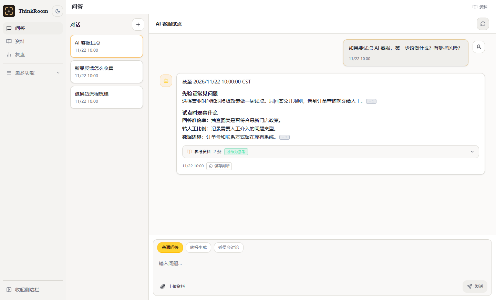

<p align="center"></p>
<h1 align="center">ThinkRoom · 思考间</h1>
<p align="center">从个人资料中提取观点和证据的开源研究工具</p>
<p align="center">
  简体中文 · <a href="README_EN.md">English</a> · <a href="#快速开始">快速开始</a> · <a href="docs/DEMO.md">体验示例</a> · <a href="docs/README.md">文档</a>
</p>
<p align="center">
  <a href="https://github.com/Gdnbit/thinkroom/actions/workflows/ci.yml"></a>
  <a href="LICENSE"></a>
</p>



ThinkRoom 保留文章、笔记和文档里的观点与原文之间的联系。当你遇到新问题，可以调取相关资料直接问答、生成简报，或通过多角色讨论比较证据、分歧与风险。

## 快速开始

需要 **Python 3.11.5 或更新的 3.11 补丁版本**和 **Node.js 20.19+**。在仓库根目录启动后端。

```bash
git clone https://github.com/Gdnbit/thinkroom.git
cd thinkroom
```

<details open>
<summary>macOS / Linux</summary>

```bash
python3.11 -m venv .venv
.venv/bin/python -m pip install -r apps/backend/requirements-dev.txt
.venv/bin/python scripts/start_backend.py --mock
```

</details>

<details>
<summary>Windows · PowerShell</summary>

```powershell
python -m venv .venv
.\.venv\Scripts\python.exe -m pip install -r apps/backend/requirements-dev.txt
.\.venv\Scripts\python.exe scripts/start_backend.py --mock
```

</details>

在另一个终端，从仓库根目录启动前端。

```bash
cd apps/frontend
npm ci
npm run dev -- --host 127.0.0.1
```

打开 [问答工作台](http://127.0.0.1:5173/chat)。上传 [示例资料](docs/DEMO.md)，问「如果要试点 AI 客服，第一步做什么？有哪些风险？」。

使用实际模型时，向后端进程提供 `OPENROUTER_API_KEY`，启动时省去 `--mock`。实际模型调用可能产生费用，并将相关资料发送给配置的提供商。 [模型体验与配置](docs/DEMO.md)

## 主要功能

| 功能 | 用途 |
| --- | --- |
| **资料入库** | 上传 PDF、DOCX、TXT、Markdown 或图片，提取并整理观点及证据。 |
| **问答** | 围绕选定资料提问，从引用返回原始依据。 |
| **简报** | 将论点、反对意见和风险整理成结构化分析。 |
| **辩论委员会** | 让不同分析角色审视同一问题，汇总交集、分歧与保留意见。 |
| **资料与复盘** | 按时间线、分类或图谱浏览资料，保存判断并记录实际结果。 |

## 文档

- [设计思路](docs/DESIGN_ORIGINS.md) · [技术架构](docs/architecture/README.md) · [性能记录](docs/operations/PERFORMANCE.md)
- [部署与运维](docs/operations/README.md) · [贡献指南](CONTRIBUTING.md) · [安全策略](SECURITY.md)

ThinkRoom 使用 React、TypeScript 与 FastAPI。数据由 SQLite 或 PostgreSQL 存储，PostgreSQL 可搭配 pgvector。

## 许可证

[Apache-2.0](LICENSE) · [第三方许可](THIRD_PARTY_NOTICES.md)
