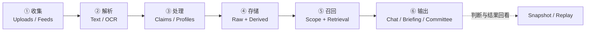

# ThinkRoom · 思考间

**让你收集的信息，不只被保存，还能参与下一次思考。**

ThinkRoom 是一个**以个人私域信息为核心、由 LLM 驱动的知识与多视角思考系统**。它把文章、笔记、文档及可选信息源的内容整理成有出处的知识；当你提出新问题时，再从这些积累中寻找相关观点，通过**日常问答、研究简报或多角色讨论**辅助理解、比较和判断。

它不是传统金融交易软件，也不只是一个「上传 PDF 后聊天」的 RAG Demo。金融研究是项目早期的重要应用场景；**收集、解析、处理、存储、召回、输出**才是更通用的设计主线。

[English](README_EN.md) · [快速体验](docs/DEMO.md) · [设计思路](docs/DESIGN_ORIGINS.md) · [技术文档](docs/README.md) · [贡献指南](CONTRIBUTING.md)

[](https://github.com/Gdnbit/thinkroom/actions/workflows/ci.yml) [](LICENSE)

## 为什么做这个项目？

你可能长期关注几位有见解的作者，也会收藏文章、上传研究文档、记录自己的思考。

问题在于：**信息越存越多，但等到真正遇到新问题时，你很难快速找回它们之间的联系。** 普通知识库擅长告诉你「文档里写了什么」，却不一定能帮你进一步比较「谁为什么这样判断」「不同观点冲突在哪里」「还有什么证据缺失」。

**举个更贴近使用场景的例子：**

你在考虑「一家小店要不要引入 AI 客服」，手里正好有三份资料：

- **作者 A 的文章：** 认为应该先从常见问题开始小规模试点，尽快收集反馈。
- **作者 B 的文章：** 提醒不要忽略客户隐私、内容准确性和长期维护成本。
- **自己的备忘：** 最常见的问题是营业时间和退换货；真实订单涉及个人信息，不能直接上传外部模型。

你想问的不是「帮我总结这三份资料」，而是：

> **这几种看法有什么交集和冲突？如果现在只能做一件事，第一步应该做什么？哪些条件还没验证？**

这正是 ThinkRoom 想解决的问题：**把资料变成可追溯、可反复召回、能够从不同角度参与新问题的思考材料。**

上面是**合成的说明案例**，不是实际客户数据，也不是已经测得的模型输出。[三份可上传的合成资料与体验步骤 →](docs/DEMO.md)

## 六个环节：从收集到输出

这是 ThinkRoom 最初设计并逐步落地的数据主线：



| 环节 | 核心设计 | 当前公开代码中的对应能力 |
| --- | --- | --- |
| **① 收集** | **高质量私域资料优先**，再按需接入公开信息 | 本地文件上传是核心入口；社媒订阅、新闻和行情有可选模块，但需要单独配置外部依赖 |
| **② 解析** | 将不同格式统一成后续可处理的文本，并尽量保留来源 | TXT/Markdown、DOCX、PDF、图片；PDF/图片可按环境使用文本层提取、OCR 或视觉模型；长图处理与解析诊断已有代码 |
| **③ 处理** | 不把原文直接当作结论，而是抽取观点、来源和证据关系 | RawSource、ClaimCard、EvidenceSpan、SpeakerProfile 等对象；包含去重、质量判断和来源关联 |
| **④ 存储** | 原始内容与加工知识分层保留，便于重算和追溯 | SQLite + Alembic；对观点进行 Embedding 索引；可选 PostgreSQL/pgvector |
| **⑤ 召回** | 根据问题找**相关且可用**的信息，而非每次重读全部资料 | 向量/关键词检索与降级机制、来源范围限制、部分路径的重排和质量约束 |
| **⑥ 输出** | 一份知识，为不同深度的问题提供不同形式的分析 | 普通问答、简报生成、多角色委员会讨论；可保存判断并对照后续结果复盘 |

**说明：** 这里的「Raw / Derived」是知识对象的**逻辑分层**，并不表示已经完整实现了早期设想中由 AI 自动维护的 Markdown Wiki。主解析器目前不提供完整的 XLS/XLSX 支持；旧版 `.doc` 也不属于受支持的正常入库格式。OCR 对复杂表格、图表和扫描件的效果需要具体测试。

### 三个值得关注的设计选择

**1. 私域知识是主体，公共信息是补充。**  
用户自己保存的高质量信息构成长期资产。社媒/新闻订阅用于扩充不同观点，行情等数据源在相关问题中用于补充事实。自动采集依赖各平台的可用性、配置、授权和合规边界，**不保证支持所有平台的无障碍抓取**。

**2. 保存原文，也保存对原文的理解。**  
RawSource 保留基础材料；ClaimCard 与 EvidenceSpan 使抽取的观点能够回到原始依据；来源画像帮助整理不同作者的表达与分析特点。这个设计受到 [LLM Wiki](docs/DESIGN_ORIGINS.md) 思路启发，但现阶段的来源画像**不能等同于准确复现某个人的思维方式**。

**3. 把「信息够不够」放在「回答得像不像」之前。**  
限定来源问答应遵守用户选定的资料范围；证据不足时保留不足状态，而不是为了生成流畅答案暗中扩大检索范围。后续判断还可以保存当时证据，和真实结果进行比较。[查看核心工作流的设计依据 →](docs/architecture/LOCAL_V01_CORE_WORKFLOW_ADR.md)

## 不同问题，切换不同思考方式

| 模式 | 适合什么时候用 | 输出重点 |
| --- | --- | --- |
| **日常问答 Chat** | 快速理解资料、概念或某位作者说过什么 | 直接回答、相关引用与必要的证据提示 |
| **简报生成 Briefing** | 需要更系统地拆解问题、形成结构化分析 | 支撑观点、反对意见、关键风险和条件性判断 |
| **辩论委员会 Committee** | 希望多个角度相互质疑、比较分歧 | 预设分析席位、多轮讨论、汇总与保留意见 |

三种模式在当前主要问答界面可以**手动切换**。后端另有基于意图的自动路由能力，但不应把它描述成新版主界面已经默认启用的交互。

委员会可以按角色配置不同模型及分析重点，但**不能保证每个席位来自不同厂商**，也没有实证证明多模型一定比单模型更准确。思想角色化和忠实模拟作者观点仍是持续研究方向。

## 不只是聊天框：信息如何被看见

当前前端的主要路径是 **问答 → 资料 → 复盘**：

- **问答：** 上传文件、观察处理进度、切换模式、查看回答和引用。
- **资料：** 核实哪些资料已入库，并从**日历、时间线、目录分类、知识图谱**等视角查看知识记录。
- **复盘：** 保存被确认的判断，之后记录结果，比较当时信息与后续事实。

此外还有来源画像、审议记录、质量监控以及市场相关的研究工具。部分是**实验性或高级功能**，不是首次体验所必需的核心链路。

## 本地启动（无需付费模型的 Mock 模式）

要求 **Python 3.11** 和 **Node.js 20.19+**（Node.js 22.20 已验证）。克隆仓库后，在根目录执行：

<details>
<summary>Windows · PowerShell</summary>

```powershell
python -m venv .venv
.\.venv\Scripts\python.exe -m pip install -r apps/backend/requirements-dev.txt
.\.venv\Scripts\python.exe scripts/start_backend.py --mock
```

</details>

<details>
<summary>macOS / Linux</summary>

```bash
python3.11 -m venv .venv
.venv/bin/python -m pip install -r apps/backend/requirements-dev.txt
.venv/bin/python scripts/start_backend.py --mock
```

</details>

**在另一个终端**启动前端：

```bash
cd apps/frontend
npm ci
npm run dev -- --host 127.0.0.1
```

然后打开 **http://127.0.0.1:5173/chat**。你可以上传 [合成观点资料](docs/DEMO.md)，体验文件入库、界面与基础技术链路；后端健康检查为 http://127.0.0.1:8000/health。

**Mock 是离线测试模式，不等于实际模型分析效果。** 它也不保证所有可选外部模块都完全隔离。实际模型调用需通过安全方式向后端进程提供 `OPENROUTER_API_KEY` 并取消 `--mock`，可能收费并将选定资料发送给服务商。不要把 API Key、个人资料或客户文件直接提交进仓库。

[完整演示和限制 →](docs/DEMO.md) · [贡献指南 →](CONTRIBUTING.md)

## 技术架构与设计文档

| 领域 | 主要实现 |
| --- | --- |
| Web | React、TypeScript、Vite |
| API / 编排 | FastAPI；入库、检索、问答、简报及委员会工作流 |
| 知识对象 | RawSource、ClaimCard、EvidenceSpan、SpeakerProfile |
| 检索 | Embedding、可选 pgvector/sqlite-vec、关键词 fallback；部分路径支持重排 |
| 数据库 | SQLite + Alembic；可选 PostgreSQL/pgvector |
| 模型 | OpenRouter、角色化模型配置与 Mock 路径 |
| 可选能力 | 社媒/RSS/新闻/行情连接、Redis/Celery/MinIO 等，需要额外依赖和验收 |

- [从最初动机到现行架构：设计脉络](docs/DESIGN_ORIGINS.md)
- [架构资料](docs/architecture/README.md) · [Local v0.1 验收边界](docs/specs/local-v0.1/SCOPE_AND_ACCEPTANCE.md)
- [公开源码审计](docs/OPEN_SOURCE_RELEASE_AUDIT.md) · [验证记录](VALIDATION.md) · [全部文档](docs/README.md)

## 适用范围与限制

**目前定位：** 本地单用户的个人知识、研究与判断复盘工具。代码中存在大量历史金融研究模块与高级实验路径；它们不代表本项目已经具备经过验证的投资建议、生产多租户隔离或互联网公开托管能力。

**仍在演进：** 更忠实的来源观点与思考方式建模、定期知识整理、多信息源体验、跨领域评测、可解释的委员会讨论。真正的模型质量需要实际输入与对照评估，不能从测试数量或 CI 绿色直接推出。

上传的资料必须有权使用，并确认允许发送给所配置的模型提供商。开发服务只应绑定本机；生产环境需要单独设计认证、TLS 和数据隔离。详见[安全策略](SECURITY.md)。

**许可：** 自有源码采用 [Apache-2.0](LICENSE)；第三方依赖及其许可证见 [THIRD_PARTY_NOTICES.md](THIRD_PARTY_NOTICES.md)。
