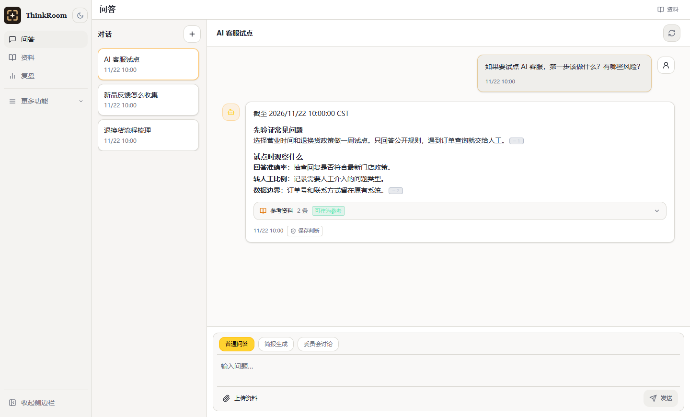

<p align="center"></p>
<h1 align="center">ThinkRoom</h1>
<p align="center">An open-source research workspace for perspectives and evidence in your own sources</p>
<p align="center">
  <a href="README.md">简体中文</a> · English · <a href="#quick-start">Quick start</a> · <a href="docs/DEMO_EN.md">Try the demo</a> · <a href="docs/README.md">Docs</a>
</p>
<p align="center">
  <a href="https://github.com/Gdnbit/thinkroom/actions/workflows/ci.yml"></a>
  <a href="LICENSE"></a>
</p>



ThinkRoom links viewpoints from your articles, notes, and documents to their evidence. Ask a question, generate a briefing, or compare how different analytical roles interpret the same sources.

## Quick start

Use **Python 3.11.5 or a newer 3.11 patch release** and **Node.js 20.19+**. Start the backend from the repository root.

```bash
git clone https://github.com/Gdnbit/thinkroom.git
cd thinkroom
```

<details open>
<summary>macOS / Linux</summary>

```bash
python3.11 -m venv .venv
.venv/bin/python -m pip install -r apps/backend/requirements-dev.txt
.venv/bin/python scripts/start_backend.py --mock
```

</details>

<details>
<summary>Windows · PowerShell</summary>

```powershell
python -m venv .venv
.\.venv\Scripts\python.exe -m pip install -r apps/backend/requirements-dev.txt
.\.venv\Scripts\python.exe scripts/start_backend.py --mock
```

</details>

In a second terminal, start the frontend from the repository root.

```bash
cd apps/frontend
npm ci
npm run dev -- --host 127.0.0.1
```

Open the [chat workspace](http://127.0.0.1:5173/chat), upload the [sample sources](docs/DEMO_EN.md), and ask “If we were to pilot AI customer support, what would we do first and what could go wrong?”

To use a live model, provide `OPENROUTER_API_KEY` to the backend process and start it without `--mock`. Live requests can incur charges and send relevant source material to the configured provider. [Model setup and demo](docs/DEMO_EN.md)

## Features

| Feature | What it does |
| --- | --- |
| **Source ingestion** | Extract viewpoints and evidence from PDF, DOCX, TXT, Markdown, and image uploads. |
| **Chat** | Ask questions within your selected sources and follow citations back to the evidence. |
| **Briefing** | Organize supporting arguments, counterarguments, and risks into a structured analysis. |
| **Committee** | Examine the same question from different analytical roles and compare agreements, disagreements, and reservations. |
| **Library and review** | Browse sources by timeline, category, or graph. Save decisions and record what happened later. |

## Documentation

- [Design notes](docs/DESIGN_ORIGINS.md) · [Architecture](docs/architecture/README.md) · [Performance](docs/operations/PERFORMANCE.md)
- [Deployment and operations](docs/operations/README.md) · [Contributing](CONTRIBUTING.md) · [Security](SECURITY.md)

ThinkRoom uses React, TypeScript, and FastAPI with SQLite or PostgreSQL. PostgreSQL can be paired with pgvector.

## License

[Apache-2.0](LICENSE) · [Third-party notices](THIRD_PARTY_NOTICES.md)
