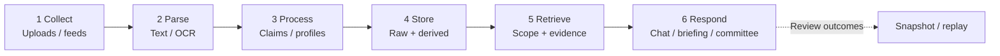

# ThinkRoom · 思考间

**Make the information you collect part of your next conversation—not just another saved file.**

ThinkRoom is an **LLM-powered, private-source-first knowledge and multi-perspective thinking system**. It turns articles, notes, documents and optional external feeds into traceable knowledge, then retrieves relevant viewpoints for **Q&A, structured briefings and multi-role deliberation**.

Financial research shaped its early design, but ThinkRoom is **not a trading platform**. Its more general design is a persistent six-stage knowledge pipeline: **collect → parse → process → store → retrieve → respond**.

[中文](README.md) · [Guided demo](docs/DEMO.md) · [Design origins](docs/DESIGN_ORIGINS.md) · [Docs](docs/README.md) · [Contributing](CONTRIBUTING.md)

[](https://github.com/Gdnbit/thinkroom/actions/workflows/ci.yml) [](LICENSE)

## Why build this?

You may follow several thoughtful creators, save articles and research papers, and keep notes of your own. But when a new question arises, it is hard to find the useful connections across everything you saved.

Imagine deciding whether a small shop should adopt an AI customer-support assistant:

- **Writer A** suggests starting with a small FAQ pilot and gathering feedback.
- **Writer B** points out privacy, answer accuracy and ongoing maintenance risks.
- **Your notes** say customers mostly ask about opening hours and returns, while order records contain private information.

You don't just want three summaries. You want to ask:

> **Where do these views agree and disagree? What is a sensible first step—and what evidence is still missing?**

ThinkRoom aims to make those source-grounded perspectives available for new questions. This is a **synthetic example**, not a real customer case or demonstrated model output. [Try the three fictional source files →](docs/DEMO.md)

## The six-stage pipeline



| Stage | Design goal | What the code does today |
| --- | --- | --- |
| **Collect** | Your own high-quality sources first; public information as optional context | Local uploads; optional social/news/market integrations require separate services and configuration |
| **Parse** | Normalize different files while retaining provenance | TXT/Markdown, DOCX, PDF and images; text extraction, optional OCR/vision, long-image handling and diagnostics |
| **Process** | Extract structured viewpoints without treating summaries as original truth | RawSource, ClaimCard, EvidenceSpan and SpeakerProfile with quality and deduplication paths |
| **Store** | Retain raw evidence alongside derived knowledge | SQLite/Alembic, embeddings for claims, optional PostgreSQL/pgvector |
| **Retrieve** | Find usable, relevant material within the requested scope | Vector/keyword retrieval and fallbacks, source scoping and selected quality constraints |
| **Respond** | Choose an analysis depth appropriate to the question | Chat, structured briefing, optional multi-role committee, and decision/outcome replay |

**Important boundary:** Raw/derived is a **logical knowledge-layer design**, not a claim that the original fully automatic Markdown-based LLM Wiki has been implemented. The primary file parser does not currently provide complete XLS/XLSX support; complex PDF/OCR extraction remains best-effort.

### Design principles

**Private knowledge first.** Material you intentionally keep is the core asset. Optional social/news subscriptions add competing perspectives; market data can provide context when useful. These connectors depend on permissions, provider availability and extra setup—not guaranteed one-click extraction from every platform.

**Keep both sources and interpretations.** The RawSource layer preserves material; ClaimCards and EvidenceSpans make derived viewpoints traceable to evidence. Source profiles summarize aspects of an author's published material, **not a guaranteed faithful simulation of that person**. The project was inspired in part by the [LLM Wiki pattern](docs/DESIGN_ORIGINS.md).

**Respect evidence boundaries.** Selected-source queries should not silently pull in unrelated material. Insufficient evidence should remain visible; a plausible-sounding response must not overwrite that uncertainty. Saved decision snapshots can later be compared with observed outcomes. See the [accepted core-workflow ADR](docs/architecture/LOCAL_V01_CORE_WORKFLOW_ADR.md).

## Three ways to think with your sources

| Mode | Best for | Emphasis |
| --- | --- | --- |
| **Chat** | Fast explanations and source-specific questions | Direct answer, citations and evidence warnings |
| **Briefing** | Structured analysis | Support, counterarguments, risks and conditional conclusions |
| **Committee** | Examining disagreement through different lenses | Predefined analytical seats, multi-round discussion and synthesis |

The current primary UI offers **manual mode switching**. An automatic intent router also exists in the backend, but is not the default workflow of the primary screen.

Models and analytical roles can be configured; this **does not guarantee distinct providers for each seat**, a faithful reconstruction of arbitrary authors, or superior decision quality.

## Beyond the chat window

The primary experience has three surfaces: **Ask → Sources → Replay**.

- **Ask:** Upload documents, follow ingestion progress, choose a mode and inspect citations.
- **Sources:** Check what was ingested using calendar, timeline, category and knowledge-graph views.
- **Replay:** Preserve confirmed decisions and compare original evidence with later outcomes.

Source profiles, deliberation records, quality diagnostics, and market-related utilities are additional or experimental paths.

## Quick start — local Mock mode

Use **Python 3.11** and **Node.js 20.19+** (Node.js 22.20 tested). From the repository root:

<details>
<summary>Windows · PowerShell</summary>

```powershell
python -m venv .venv
.\.venv\Scripts\python.exe -m pip install -r apps/backend/requirements-dev.txt
.\.venv\Scripts\python.exe scripts/start_backend.py --mock
```

</details>

<details>
<summary>macOS / Linux</summary>

```bash
python3.11 -m venv .venv
.venv/bin/python -m pip install -r apps/backend/requirements-dev.txt
.venv/bin/python scripts/start_backend.py --mock
```

</details>

In another terminal:

```bash
cd apps/frontend
npm ci
npm run dev -- --host 127.0.0.1
```

Open **http://127.0.0.1:5173/chat**, then try the [synthetic perspective files](docs/DEMO.md). Backend health: http://127.0.0.1:8000/health.

**Mock checks the technical path, not real reasoning quality**, and may not isolate every optional data service. For live models, securely inject `OPENROUTER_API_KEY` into the backend process and omit `--mock`. Requests may incur costs and transmit selected material to the configured model provider. Never commit real keys or private data.

## Stack and documentation

React / TypeScript / Vite; FastAPI; RawSource–ClaimCard–EvidenceSpan–SpeakerProfile; SQLite + Alembic; optional PostgreSQL/pgvector; embeddings and retrieval fallbacks; configurable OpenRouter models. Optional external feeds, Redis, Celery and MinIO require additional configuration.

- [Design origins and capability assessment](docs/DESIGN_ORIGINS.md)
- [Guided synthetic demo](docs/DEMO.md) · [Architecture](docs/architecture/README.md)
- [Local v0.1 acceptance boundary](docs/specs/local-v0.1/SCOPE_AND_ACCEPTANCE.md) · [Documentation index](docs/README.md)
- [Release audit](docs/OPEN_SOURCE_RELEASE_AUDIT.md) · [Validation](VALIDATION.md)

**Scope:** This is a local single-user research tool—not a validated trading system, public multi-tenant hosted service, or proven improvement over single-model Q&A. Complete author-faithful Mind agents, automatic knowledge maintenance and broader cross-domain evaluations remain directions for future work. OCR accuracy varies with the material and runtime. Overwrite restore is an offline operation.

Use only materials you are permitted to process and send to your model provider. Keep local development listeners on loopback. See [SECURITY.md](SECURITY.md).

Original contributions are licensed under [Apache-2.0](LICENSE); external libraries keep their own terms. See [THIRD_PARTY_NOTICES.md](THIRD_PARTY_NOTICES.md).
