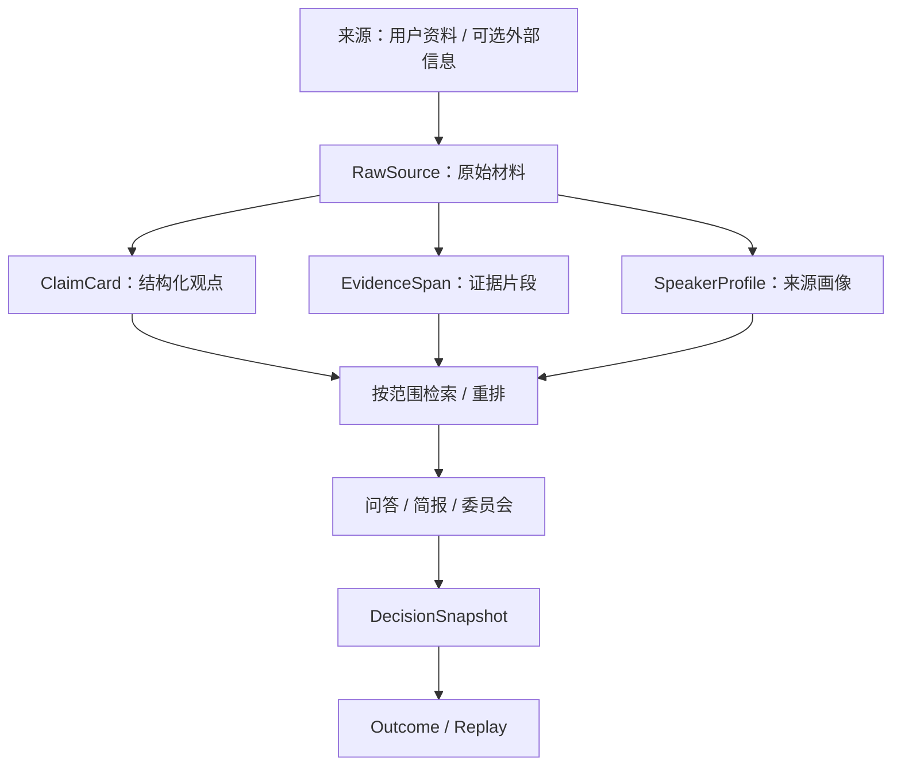

# ThinkRoom 的设计脉络：从个人信息积累到多视角思考

[项目首页](../README.md) · [English](../README_EN.md) · [演示](DEMO.md)

> 这是一份**设计解释与当前代码对照**，不是所有历史构想都已落地的功能清单。历史文档保留了当时的假设；是否可在现有程序中运行，以代码和 Local v0.1 验收边界为准。

## 1. 先解决的问题不是“模型不够聪明”

最初的使用痛点是：用户持续阅读文章、关注博主、保存报告、记录自己的判断，但信息通常分散在聊天记录、收藏夹、PDF、截图和不同平台。新的问题出现时，材料难以重用，而通用聊天模型也不知道这些长期积累的上下文。

因此，ThinkRoom 的出发点不是传统金融行情终端，而是：

1. **让私域高质量信息易于进入系统。**
2. **留下原文，定期或按需提炼出可组织的观点。**
3. **在需要回答新问题时，优先利用这些有出处的知识。**
4. **允许不同分析视角质疑、补充、交锋，而不是只有一段顺从的总结。**
5. **保存重要判断和对应证据，事后能回看对错和遗漏。**

金融研究是最早、最深入的实验场景。因此代码里还有市场行情、宏观事件、策略、资金流、基金工具等模块。它们不能反过来定义整个项目的长期定位。

## 2. 核心六阶段：初始设计与当前实现

| 阶段 | 原始思考 | 当前实现 / 界限 |
| --- | --- | --- |
| 收集 | 用户上传私域信息为主；社媒、新闻、公开行情为补充 | 已有用户上传、社媒订阅同步、新闻/行情相关代码。社媒连接可能要求 RSSHub、MediaCrawler、We-MP-RSS 等额外服务与登录状态；不是所有平台开箱即用 |
| 解析 | 把文字、图片、PDF、Word 等格式还原为统一文本；长图分块、OCR 去重 | 现行 `file_parser.py` 支持 txt/md、docx、PDF、常见图片和长图处理；复杂 OCR 是 best-effort。主解析器不提供完整 xls/xlsx 支持，旧 `.doc` 会在正常入库时被拒绝 |
| 处理 | 原始内容保留；LLM 提炼观点、逻辑链与来源画像；可维护衍生知识 | RawSource、ClaimCard、EvidenceSpan、SpeakerProfile 及相关工作流存在；存在去重、入库质量门禁、来源关系和知识健康检查。最初设想的全自动 Markdown Wiki 不是当前交付物 |
| 存储 | RAW 与加工知识分层，向量化以便后续使用 | SQLite/Alembic 存储原始与衍生知识对象，Claim 等建立 embedding 索引，可选 pgvector。并非所有原始字节都被独立向量化 |
| 召回 | 结合问题检索有用的知识，控制上下文量并参考用户的来源信任判断 | 语义向量、SQLite/pgvector、关键词降级等路径；选定来源范围、质量/时间/立场与部分重排逻辑按模式生效。不是简单“库小时逐条暴力对比，大了才用 RAG” |
| 输出 | 问答、深度简报、多模型委员会、自动意图路由 | 三种模式均有代码与页面。当前主要问答界面手动切换；自动路由存在于后端。委员会不是默认模式，也尚无受控评测证明质量优于单模型 |

## 3. RAW 与 Wiki：保留原始事实，也保留加工理解

这个理念来自早期的 [个人 Agent 与 LLM Wiki 构想](architecture/PERSONAL_AGENT_SYSTEM.md)：

- **RAW：** 原文是回溯的依据，不能让摘要替代来源。
- **衍生知识：** 抽取观点、组织关联、记录作者/信息源画像，形成更适合召回的单元。
- **使用与反馈：** 问问题、形成结论后仍能回到来源；有价值的结果和后续事实可以形成新的记录。

在实际数据模型中，这更接近：

这不是“克隆某个人的意识”。来源画像主要表示可整理的**公开表达、长期观点和分析习惯**；从这些资料推断一个人面对新事件必然会怎么想，目前既没有可靠保证，也不应在 README 里当成既有能力。

## 4. 公共数据的角色：补充，而不是淹没私域信息

最初希望按账号订阅博主内容，并把社媒、新闻与行情用于扩大证据范围。

当前仓库包含 `social_subscription_service.py`、`social_media_mcp.py`、`scheduler.py` 等模块，具备同步、去重、入库和调度设计，但运行依赖实际平台接口与第三方服务，不能把“有适配代码”理解为“每个平台都可靠、无需登录并可稳定抓取”。

**关于行情持久化的设计变化：** 早期介绍曾倾向将行情按需查询、不长期存储；随后 [DATA_LAYER.md](architecture/DATA_LAYER.md) 又设计了 `market_snapshots` 等历史快照表和定时抓取。因此现行实现**确实可以存储一部分市场快照**。两者是不同阶段的设计决策，不能只拿最早版本做当前功能声明。

## 5. 为什么有三种输出，而不是单一 Chat？

- **Chat：** 低摩擦地解释、引用和回答。
- **Briefing：** 需要更系统分析时，展示支撑、反对、风险和条件。
- **Committee：** 用多个预设席位提出不同论点，记录分歧与汇总。

“多个模型”不等于天然客观，也不等于必然更准确。历史设计里有共享证据包、角色附件、差异化模型与匿名汇总等构想；具体策略以当前 `committee_workflow.py` 和相关技能实现为准，**不能假定所有早期细节都已落地**。需要用可复现评测比较准确率、成本、延迟及证据可靠性，才能做效果承诺。

后端 `mode_router.py` 还包含自动意图路由，但当前主 UI 默认仍是手动选择三种模式。这两层不冲突。

## 6. 数据不会因为输出一段答案就失去上下文

Local v0.1 把“**限定来源 → 有证据地回答 → 保存判断 → 记录结果 → 回看**”视为核心闭环。

- 限定来源查询不得悄悄扩大到无关资料。
- 当证据不足时，要保留不足状态，而不是硬生成一个自信答案。
- DecisionSnapshot 保存决策时的材料与判断，不用新信息偷偷覆盖历史证据。
- Outcome 和 Replay 可以比较过去的判断与后来发生的事。

参见 [Local v0.1 ADR](architecture/LOCAL_V01_CORE_WORKFLOW_ADR.md) 与 [验收范围](specs/local-v0.1/SCOPE_AND_ACCEPTANCE.md)。

## 7. 未来路线与不应宣称的能力

现阶段明确**不能**直接宣称：

- 任何作者都可以被忠实地模拟成独立思想 Agent；
- 社媒内容可以在任何平台稳定自动抓取且无需授权；
- 图片、PDF、旧 Word、Excel 和任意复杂文档都能完整无损解析；
- 全自动 Markdown Wiki 和知识维护体系已经实现；
- 委员会讨论一定比普通 LLM 更准确；
- 通过了 CI 就意味着可供公网多用户生产部署；
- 市场研究模块具备经过验证的投资决策能力。

值得继续建设的方向：来源画像忠实度的可测评提升、知识过时与矛盾的持续维护、信息源接入的实际稳定性、跨领域评测、可解释的多视角讨论，以及更轻量的用户体验。

## 8. 可核对的资料与源码

设计参考：

- [个人 Agent 与 LLM Wiki](architecture/PERSONAL_AGENT_SYSTEM.md)（更广泛的最初愿景）
- [V2_DESIGN.md](architecture/V2_DESIGN.md)（早期结构方案）
- [PIPELINE_ANALYSIS.md](architecture/PIPELINE_ANALYSIS.md)（历史获取与处理链路评估）
- [DATA_LAYER.md](architecture/DATA_LAYER.md)（行情快照演进）
- [RECALL_TO_ANSWER_REVIEW.md](architecture/RECALL_TO_ANSWER_REVIEW.md)（历史召回评估）
- [Local v0.1 ADR](architecture/LOCAL_V01_CORE_WORKFLOW_ADR.md)（当前正式范围）

实现入口：`apps/backend/app/services/file_parser.py`、`apps/backend/app/workflows/ingestion_workflow.py`、`apps/backend/app/services/semantic_search.py`、`apps/backend/app/services/social_subscription_service.py`、`apps/backend/app/services/mode_router.py`、`apps/frontend/src/pages/DecisionChatFlow.tsx`。

本文不会把任何历史评估文档中的“已完成”标记，当作最新公开代码的充分验证。
