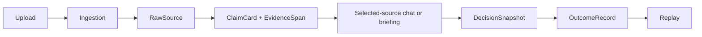

# ADR: Local v0.1 Core Workflow

Date: 2026-07-12

Status: accepted and frozen for local v0.1

## Context

The repository contains a broad set of historical pages, APIs, model workflows,
verification tools, production scaffolding, and hundreds of incremental hardening
records. Continuing to expand all of them obscured the product's primary promise:
preserve user-selected information, reason within that evidence boundary, and later
compare the decision with observed outcomes.

The local v0.1 therefore needs one explicit closed loop, trustworthy failure behavior,
and replayable evidence. It does not need another framework migration, new Agent roles,
or production infrastructure.

## Decision

The accepted architecture is:

### Raw Evidence Layer

RawSource is the retained source of record. Processing may enrich its status, summary,
hash, and diagnostics, but the original extracted text remains available for audit.

ClaimCard is an indexed reasoning unit, not the sole citable truth. Every accepted claim
must retain a RawSource link and, where available, an EvidenceSpan with exact quote,
character range, page, timestamp, or extraction method. Retrieval can use ClaimCards;
audit resolves back to source evidence.

### Selected-source Reasoning Layer

Chat and briefing receive explicit source IDs. The system resolves those IDs and must not
silently widen to unrelated knowledge, market data, news, or Web results. Query/source
mismatch is treated as insufficient evidence.

Chat uses inline citations and a visible quality guardrail. Briefing and committee use
field-level evidence status so that direct support, evidence-based inference, scope
assessment, model-derived assessment, policy control, and insufficiency are distinguishable.

### Evidence-first Failure Behavior

Evidence sufficiency is checked before model invocation. When evidence is insufficient:

- model call count is zero;
- provider cost is zero;
- the result is non-actionable;
- material fields still carry `insufficient` status;
- the selected source scope is retained in the response.

This is a stronger invariant than asking a model to abstain after it has already been
called.

### Decision and Outcome Layer

DecisionSnapshot freezes the evidence and decision state at the time of a briefing or
accepted chat decision. It is not regenerated from current data during replay.

OutcomeRecord stores later observations and review notes. Snapshot annotation provides a
direct outcome/replay workflow while OutcomeRecord preserves the independent outcome log.

Replay compares the frozen evidence with the observed result. Its model response is bound
to a strict seven-field JSON Schema. Partial JSON is a failed replay, not a successful
analysis. The default and minimum output budget is 3000 tokens because the configured
reasoning route produced incomplete output below that budget during live acceptance.

### Committee Policy

Committee is an explicit optional branch. Its route contract and evidence behavior are
tested, but it is excluded from the default local v0.1 path. It may become a default only
after a controlled evaluation shows a material quality improvement over briefing at an
acceptable latency and cost.

### Runtime Policy

The accepted runtime is one local backend process with SQLite and an in-process ingestion
threadpool. OpenRouter credentials are supplied by the SOPS-backed launcher. The launcher
also establishes one explicit database profile:

- `user` (default): `.runtime/data/user/local-v0.1.db`;
- `test`: `.runtime_test_dbs/live-profile-<port>.db`, required for verification writes;
- `legacy`: the retained SOPS database URL, available only by explicit maintenance choice.

SQLite connections enable foreign-key enforcement. Verification mutation endpoints reject
non-test profiles. Redis and distributed workers are not required for v0.1. This decision
is deliberately incompatible with a production or multi-instance claim.

### User Surface Policy

The product exposes the core workflow through three primary surfaces: Ask, Sources, and
Replay. Upload and manual mode selection stay in Ask; Sources confirms file availability
and processing; Replay contains user-confirmed decisions, outcome entry, and replay.

User-facing information is layered:

- default: result, reference time, inline citations, material warning, processing result,
  and next action;
- on demand: file stages, source excerpt, publisher or author, applicable time, and source
  location;
- maintenance only: model/provider identity, cost, raw trace, internal IDs and enums,
  system tests, database explorers, and quality dashboards.

This is a presentation boundary, not a data deletion. Existing APIs, stored provenance,
secondary routes, and audit fields remain available to maintenance workflows. User and
test sessions are separated by database profile; titles and UI regexes are not trusted as
an authorization or isolation boundary.

## Alternatives Not Chosen

- Continue production hardening: rejected because it expands scope without validating the
  primary user loop.
- Introduce LangChain/LangGraph or another Agent runtime now: rejected because the current
  blocking defects were evidence contracts and persistence correctness, not orchestration
  syntax.
- Make committee the default: rejected because quality uplift has not been demonstrated.
- Introduce GraphRAG now: rejected because source/claim/evidence integrity and outcome
  feedback must be stable before adding another retrieval abstraction.
- Delete old artifacts: rejected because it violates the preservation requirement.
- Reorganize historical artifacts without an index: rejected because it risks breaking
  traceability.

## Consequences

Positive:

- one closed workflow has executable and real-provider evidence;
- scope and failure behavior are explicit;
- model routing can be reconciled through fingerprints;
- outcome and replay no longer silently accept partial model output;
- historical work remains recoverable.
- the primary user path no longer depends on understanding internal workflow or storage
  terminology.
- user startup cannot silently write automated verification records into the accepted
  user database.

Tradeoffs:

- the local worker is not durable;
- optional Redis degradation remains visible;
- format and OCR quality are best-effort outside the controlled fixture;
- financial decision quality is not established;
- many historical pages and APIs remain in the repository but outside the v0.1 acceptance
  boundary.
- legacy records still lack uniform row-level origin metadata; the isolated user candidate
  therefore uses a documented provenance-closure migration rather than destructive cleanup.

## Documentation Governance Amendment

After the runtime decision was frozen, the product owner explicitly approved a
documentation-only structural move. Timestamped verification runs and hardening passes
were moved without deletion or byte changes into categorized archive directories. The
deterministic `docs/archive/ARCHIVE_INDEX.json`, Git history, stable filenames, and hygiene
gate preserve traceability. This amendment does not change the runtime architecture or
invalidate v0.1 evidence.

## Revisit Triggers

Revisit this ADR only when one of these is true:

- real usage shows a repeatable core-flow defect;
- outcome backfill supports financial calibration work;
- a committee comparison proves measurable uplift;
- production deployment becomes an explicit new objective;
- a source format cannot be handled within the current parser contract.
